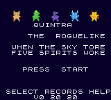
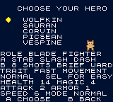

# Getting Started

The title shows QUINTRA, the line THE ROGUELIKE, and the five spirits. Under them a lore line turns. The footer reads SELECT RECORDS HELP, and under that the version, v0.20.20. The source string has a plus between RECORDS and HELP. The title font does not draw that plus.

Caption: Title, captured headless from the current cartridge. Nearest-neighbor. The lore line changes while you wait.

Caption: Class select, same capture. MODE NORMAL is the mode you are in. SELECT moves to Easy.

- If no run is suspended, press START.
- If a run is waiting, A continues it. START begins a new expedition and leaves the old one.
- SELECT opens Records, then Help. Records lists best score, runs, wins, fallen, and a fast win when one exists. Help is two pages: the journey, then the controls. A turns the page. B goes back.

There is no difficulty row on the title. Difficulty is chosen with the champion.

## Choose a vessel

The class screen says CHOOSE YOUR HERO. Move the cursor. Each row shows a role, the A weapon in plain words, the B power, and a trait. A live preview stands in that champion’s colors. A confirms. B returns.

SELECT toggles the mode, and the screen names the mode you are in.

- NORMAL is the default. It is the intended game. There is no Hard setting.
- EASY raises maximum health to at least eight hearts, adds 4 attack and 2 defense, and softens a number of patterns. The screen also prints EASY MORE HP FEW HEX. Those last two words are on the glass; this booklet does not assign them a separate rule beyond the Easy changes in the cartridge.

The Pack later shows EASY or NORMAL and does not let you change it. A suspended run keeps the difficulty it started with. An old save from before difficulty existed loads as Normal.

## What a run is

Nine dungeons, three to a region. A village sits between regions. After a dungeon you cross Riftwild, a six-by-six country, and the next gate is waiting. Rooms, routes, and most encounters are dealt from the run’s seed. A few landmarks keep their role even when the path bends.

You are looking for a sigil. The game’s own journey page says: find the sigil key, clear the colossus, cross Riftwild. Secrets hide echoes. The map, then A, asks your echo.

Clearing the ninth colossus records a win.
