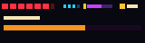

# The Window

The strip along the bottom is a window, not part of the room. It sits on the last eight scanlines.

Health is counted in half-hearts. Two points of health are one full heart. A heart can show full, half, or empty. Wolfkin begins at 14, which is seven hearts. Vespine begins at 13, six hearts and a half. Easy raises the maximum to at least 16, eight hearts, if the champion had fewer.

Magic sits beside the hearts as a short row of pips. Will is not health and not danger. Its color runs toward purple as it charges. The window shows a stored-tier digit and the bar of the next tier. You begin at tier 1. Finding the Titan Glove, the Tide Raft, or the Rift Hook each raises the cap by one, up to four. Owning the tool is enough. You do not have to keep it in hand, and you cannot lose the tier by swapping.

Coins are the gold mark. A colossus adds a longer bar of its own.

The same strip names the most urgent condition. While a temporary boon is up, it can read BOOSTED. The Status page is the long form: the condition and its duration, every curse and how many rooms it has left, Weapon Surge, and the signature timers that need them. Green and gold rows are boons. Red and violet rows are harm. Messages queue, so a relic that changes two stats does not swallow one of them.

## What you just picked up

Everything you touch names itself in the middle of the strip for about two seconds. If it stays on the floor, the strip says why.

- A heart refill reads HEAL+1, or HEAL+2 from a shop. A magic wisp reads MANA+1.
- A gold heart is an Iron Heart, a heart container: MAX, a gold heart, +2. At the eight-heart limit it reads a gold heart and MAX. If you are hurt it still mends two health; at full health it stays put.
- A pale white heart is a heart you cannot use yet. Hunger or a curse is on you, and the strip says HUNGER or CURSE, then NOHEAL.
- Stat relics read the stat: ATK+1, DEF+1, SPD+1, LCK+2, MP+2. A stat at its limit reads ATKMAX, SPDMAX, and so on, even when the relic’s other stat still applies.
- Relics with a verb name it: VAMP, WARD, FORK, BOUNCE, THORNS, DRUM, FLASK, BLAST, BEAM, REVIVE. Tools name theirs: BURST for the Rift Bomb, CHIME, MIRROR, CURE+1 for an Antidote.
- The Glass Fang pact shows the price as well as the gift: ATK+2, SPD+1, MAX heart −2.
- A weapon orb on the floor reads A SWAP. Press A to trade; the strip then says WEAPON.
- At the counter: NEED and the price when the purse is short, OWNED for a unique you already carry, NOROOM when the pack or the vial pouch is full, KNOWN for a chart of a route you already hold. A full purse refuses a coin with the coin mark and MAX.
- A Wildcard says what it did: HEALED, CLEAN, a coin amount, a stat, or CURSE followed by the cost (HURT+1, LCK−2, ATK−1, or HUNGER and NOHEAL).

Caption: A diagram of the window, not a photograph of the glass. Hearts, magic, Will, coin, and the colossus bar.

Cracked walls keep the same amber glow in every dungeon. That color means “shoot this.” Secret rooms sit behind it.
