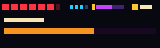

# The Window

The strip along the bottom is a window, not part of the room. It sits on the last eight scanlines.

Health is counted in half-hearts. Two points of health are one full heart. A heart can show full, half, or empty. Wolfkin begins at 14, which is seven hearts. Vespine begins at 13, six hearts and a half. Easy raises the maximum to at least 16, eight hearts, if the champion had fewer.

Magic sits beside the hearts as a short row of pips. Will is not health and not danger. Its color runs toward purple as it charges. The window shows a stored-tier digit and the bar of the next tier. You begin at tier 1. Finding the Titan Glove, the Tide Raft, or the Rift Hook each raises the cap by one, up to four. Owning the tool is enough. You do not have to keep it in hand, and you cannot lose the tier by swapping.

Coins are the gold mark. A colossus adds a longer bar of its own.

The same strip names the most urgent condition. While a temporary boon is up, it can read BOOSTED. The Status page is the long form: the condition and its duration, every curse and how many rooms it has left, Weapon Surge, and the signature timers that need them. Green and gold rows are boons. Red and violet rows are harm. Messages queue, so a relic that changes two stats does not swallow one of them.

Caption: A diagram of the window, not a photograph of the glass. Hearts, magic, Will, coin, and the colossus bar.

Cracked walls keep the same amber glow in every dungeon. That color means “shoot this.” Secret rooms sit behind it.
