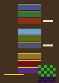

# The Road

Nine dungeons, in this order. Three make a region. A village follows the region. Then Riftwild.

1. Crystal Caverns. Cool blue. The first colossus is a lesson in patterns, not a race.
2. Verdant Hollow. Moss and green.
3. Ember Depths. Molten red.
4. Frost Vault. Ice.
5. Toxic Mire. Sick yellow-green.
6. Shadow Keep. Grey and violet. Collapsing floors.
7. Golden Temple. Sand and gold.
8. Bloodmoon. Crimson.
9. Void Sanctum. Deep purple and a toxic green. The last of the nine.

Caption: The campaign order, not a map of one seed. Villages sit after each region. The grid is Riftwild, Waking above and Hollow suggested beneath.

Each dungeon is a procedural grid, up to six by five cells, with a mini-boss, a merchant, and a colossus. A mini-boss pays a weapon orb and does not advance the stage. Only the giant does that. Foyers are gentler. The rooms after them are not. Shoot amber cracks. The color does not change with the biome, so you can trust it when the floor is already gold or already violet.

Riftwild is thirty-six screens, six by six. Waking Riftwild is the living country. Hollow Riftwild is the same geography with the life pulled back: the ground breaks, and the water thins. Routes you remember become puzzles because the ground changed and the exits did not. Worldglass is the verb that flips them.

Hollow is not a recolor. On Normal it adds four bodies to a field. On Easy it adds two. The relics that only exist there are the reason to bear it.

Wayfarers are peaceful. Press A. They point at sleeping arches, tool-gated groves, the Farfold cave, and vaults that do not refill. An arch that sleeps is not broken. Another arch is burning. Follow the map. A warden on an arch must fall before that fire wakes.

The sigil is the dungeon key. Claim it and the trial awakens. Clear the colossus and the road opens. One heart is given as you leave the arena, if you can be healed, and two more hearts and coins are dropped for you to walk over. A class-attuned relic drops with them. Do not dash past it because the victory music is playing.

Between regions the village refills health and magic, sells, and gives you a moment when nobody is shooting. Use it. Normal does not hand you a heart for every scrape. An ordinary alpha drops a half-heart only while you are at half health or lower. Above that it pays five coins. An elite still drops a half-heart whenever you are missing any health. Other bodies, on Normal, drop a half-heart about twelve times in a hundred. On Easy that chance is about twenty-eight in a hundred, and an alpha’s half-heart is not withheld above half health. Spend coins on the thing that fixes the death you just had, not on the relic that looks rarest.
