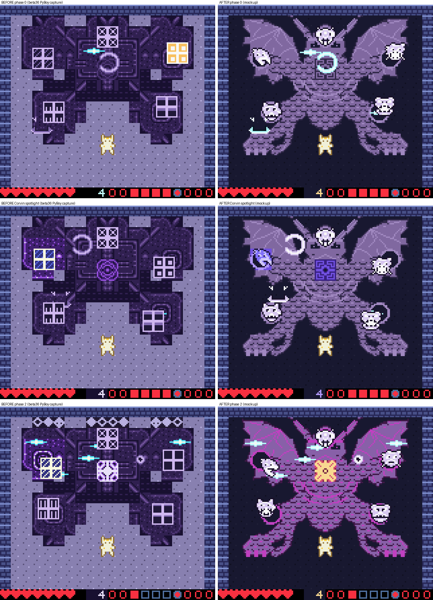
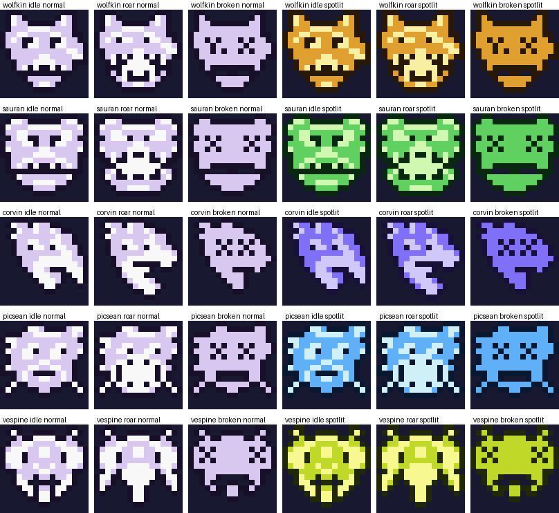
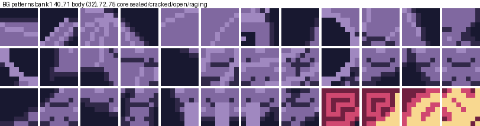

# Hexa Dragmar redesign: art, contrast, and fight (proposal)

Status: **proposal for owner review. Nothing here is implemented.** Built
from three Gemini Argon passes (critique and spec, pixel data, mockup review)
plus headless PyBoy measurements of beta36 (`5060e765`). The mockups are
rendered from real CGB VRAM, OAM and palette data. A compositor applies the
proposed tiles and palettes to captured beta36 frames, so the hero, HUD,
walls and shots are real game state.

## 1. What is wrong today

The owner's three findings, all confirmed:

1. **It reads as a building, not a dragon.** `hexa_bg_map` is a stepped
   H-shaped slab. `gen_limb_tiles()` draws each 16×16 head as four 8×8
   cells, each with a bright color-3 border. That border is the
   "window pane" look.
2. **Floor and monster contrast is too low.** Palette gate on beta36:
   floor vs body c2 is **1.20:1**, floor vs body c3 is **2.05:1**, and
   floor vs limb c2 is **2.50:1**. Pixel classes on the captured frames
   (WCAG):
   - Floor vs limb pixels averages 1.21:1, and the limb pixels overlap the
     floor's luminance band.
   - Floor vs shots is 1.24:1 during a spotlight.
   - Floor vs hero is 2.2:1.

   There is also a bug. `floor_bg` in `hexa_bg.c` is dead code:
   `room_load_environment_palettes()` and `room_apply_pause_palettes()`
   reload `BGPAL_FLOOR` with Crystal Caverns' floor. `room_is_arena()` is
   false in the sanctum, so the on-screen floor is
   (4,3,6)/(11,10,15)/(17,16,22)/(23,22,28).
3. **Center spam wins.** In a headless sim (Wolfkin, Normal and Easy), the
   player stands still at the spawn point (72,96), faces up and taps A.
   The boss dies in **87 s** and the player loses **0 half-hearts**.
   - Phase 0 (0–59 s): shots up the center column hit Vespine at (72,16).
     Every limb hit drains shared HP (cap 3). A break adds 15 HP. There is
     no per-hit cooldown.
   - Phase 1 (59–74 s): HP ≤ 127 opens the core at (72,40). The core sits
     in the same column and is gated only by Sauran's 28-tick guard.
   - Phase 2 (74–87 s) lasts 13 s. Nothing threatens the spawn lane. The
     phase-1 roar and limb breaks clear hostile shots, and the phase-2
     radials expire before the outer lane.

## 2. Art direction: six-fold sovereign dragon

The new design is a horned sovereign skull above the core, with:

- a ribcage around the core;
- two bat wings filling the upper corners, with bone spars and scalloped
  trailing edges;
- serpentine scaled necks to the five head sockets;
- planted foreclaws with bright talons;
- the bottom-center hero bay kept clear (footprint x 40..87, y ≥ 88).

The art is mirror-symmetric about screen x = 80, which every anchor
already is. Collision is unchanged: only the five 16×16 heads and the
16×16 core collide, and all body tiles stay walkable.

Each limb head becomes one hand-authored 16×16 creature head instead of
four boxed cells:

- Wolfkin: wolf-drake.
- Sauran: horned drake.
- Corvin: raven-wyvern.
- Picsean: frilled leviathan.
- Vespine: wasp-dragon crown.

There are three poses: idle, roar (telegraph and active), and broken.

Phase looks:

- **Phase 0:** the core is sealed rib-armor on BG5.
- **Core window:** the core shows the open gold/red heart on BG6.
- **Phase 2:** one BG5 palette load turns the highlights into magenta
  veins, (17,12,21)/(24,8,24), with zero tile writes. The core shows the
  "raging" tile.

## 3. Budget (same or justified)

| Item | beta36 | Proposal | Cost |
| --- | --- | --- | --- |
| BG patterns | 16, bank-1 40..55 | **36**, bank-1 40..75 (32 body + 4 core states) | Once at entry. 320 more bytes of ROM. Bank-1 BG 56..127 measured empty in the sanctum |
| Limb OBJ tiles | 40, bank-1 88..127 (2 poses) | **60**, bank-1 68..127 (3 poses) | Once at entry. Bank-1 OBJ 0..87 measured empty in the sanctum |
| `gen_limb_tiles()` | runtime loop, 640-byte WRAM buffer | const ROM data, `set_sprite_data` | Removes CPU work and frees 640 bytes of WRAM |
| Spotlight change | 16 socket + 4 core attr writes | ≤ 8 attr writes (2×2 collar + core), or 0 if the spotlight is OBJ-palette only (Argon's preference) | ≤ beta36 |
| Phase change | 4 core tiles + 4 attrs | 4 core tile ids + 1 BG5 palette load (phase 2) | ≈ beta36 |
| OAM / scanline | 20 limb sprites, ≤ 4 per line | unchanged | 0 |
| Per frame | — | `core_open_timer` + `part_hit_cd[6]` decrements, under 40 T-states | ≈ 0 |

ROM: bank 15 has only 318 bytes free, so move `hexa_bg.c` and the new art
to `#pragma bank 255` (banks 17..31 are empty). `room_tile_walkable()`
must treat 40..75 as walkable in the sanctum. A test must prove nothing
else writes bank-1 BG 56..75 or OBJ 68..87 while the sanctum is live.

## 4. Palettes (hard requirement: floor vs monster contrast)

The luminance order is: dark floor, then mid-tone body, then bright heads,
shots and hero. Colors are r,g,b on the 0..31 scale.

| Slot | c0 | c1 | c2 | c3 |
| --- | --- | --- | --- | --- |
| BG0 floor (sanctum-owned) | 1,1,2 | 2,2,4 | **3,3,6** (dominant) | 4,4,7 |
| BG5 body | 3,3,6 | 6,5,9 | **16,13,20** | 20,17,24 |
| BG5 phase 2 | 3,3,6 | 8,3,9 | 17,12,21 | 24,8,24 |
| BG6 open core | 3,3,6 | 14,4,8 | 26,9,14 | 31,27,18 |
| OBJ5 heads | – | 3,2,5 | 27,25,30 | 31,31,31 |
| OBJ3 warm shot | – | 3,1,2 | 31,25,22 | 31,31,30 |
| OBJ4 cool shot | – | 1,3,4 | 22,31,31 | 30,31,31 |
| OBJ7 telegraph | – | 31,24,12 | 31,31,20 | 31,31,31 |

BG6/OBJ6 spotlight variants are in `argon/pixels.json`. Each is a class hue:
amber for Wolfkin, emerald for Sauran, indigo for Corvin, cobalt for
Picsean and chartreuse for Vespine. OBJ1, the hero palette, is shared and
unchanged.

Contrast on the palettes (gate thresholds are in
`scripts/test_hexa_body_art_and_contrast.py`):

| Pair | beta36 | proposal | min |
| --- | --- | --- | --- |
| floor / body c2 | 1.20 | **3.63** (phase 2: 3.54) | 3.0 |
| floor / body c3 | 2.05 | **5.59** | 3.0 |
| floor / limb c2 | 2.50 | **11.09** | 3.0 |
| body c2 / warm shot c2 | 3.64 | **3.15** | 3.0 |
| body c2 / cool shot c2 | 6.54 | **4.00** | 3.0 |
| floor / warm shot c2 | 4.39 | **11.45** | 3.0 |
| floor / cool shot c2 | 7.87 | **14.54** | 3.0 |
| floor / hero c1 | — | 14.98 | — |
| body c2 / hero c1, c3 | — | 4.12, 3.02 | — |

Pixel-class means on the mockup frames:

- floor/body: dominant 3.63, mean 2.7 (the mean includes the intended 1-px
  outlines).
- floor/limb: mean 8.5–9.2.
- body/shot: mean 4.6–5.5.

In grayscale, the floor, body and sprites sit in distinct bands. Average
gray is 27 for the floor, about 83 for the body, about 150 for the heads,
188 for the hero and over 207 for the shots.

The known weak spot is a warm shot crossing a body c3 highlight, at about
2.0:1. Shots keep their dark c1 outline there.

## 5. Fight redesign (Argon spec, numbers to tune in playtest)

**Gating.** The core is **armored** until the player breaks limbs, then
opens in a **210-tick window** (240 on Easy):

- In phase 0, the window opens after any 2 limb breaks, or 1 spotlit limb
  break. On Easy, 1 break of any limb opens it.
- While the window is open, the core takes up to 6 per hit.
- While sealed, shots deflect for 0 damage with a tick SFX.

**Limb damage.**

- A spotlit limb takes up to 4 HP and 6 stagger per hit. Breaking it adds
  20 HP and opens the core.
- An unlit limb takes **1 HP per hit** in phases 0–1 and 0 in phase 2,
  plus full stagger. It breaks at 48 stagger (36 on Easy) for 15 HP.
- A 6-frame per-part hit cooldown applies.
- A broken limb stays down for 300 frames (360 on Easy).

**HP.** 255 on Normal, 200 on Easy.

**Phases.**

| Phase | HP | Core | Escalation |
| --- | --- | --- | --- |
| 0 The Five Seals | 255..150 | sealed; windows on breaks | base schedules; spotlight 150 on / 75 off |
| 1 Sovereign Awakes | 149..75 | opens 180 ticks on transition, then reseals; 1 break opens it | 40-tick roar; idle −6; skull Dragon Breath, 2 fast bolts down the player's column every 180 ticks; spotlight gap 45 |
| 2 Six-Spark Overdrive | 74..1 | unlit chip damage 0 | 40-tick roar plus vein palette; idle −10; every 200 ticks a 45-tick telegraph, then 6 radial and 2 aimed bolts (ttl 38) reaching the bottom lane |

**Spawn-lane denial.**

- Vespine Stinger ttl goes from 24 to 44, so it reaches y ≈ 110.
- Corvin Raven Mark locks onto the hero's position, including y = 96.
- Wolfkin and Sauran shots are aimed at the hero. Idle reloads are 37/31/27
  and 43/37/33 for phases 0/1/2.

Goal: no standing spot is safe for more than about 3 s. Fairness keeps the
existing shunt: at most 2 attacks resolve on one frame, and the spotlight
never pauses another limb.

**Easy.** Telegraphs get +4 ticks, and non-signature speed 4 drops to 3.

**Targets.**

| | Fight length | Half-hearts lost |
| --- | --- | --- |
| Normal | 55–75 s | 3–6 |
| Easy | 35–50 s | 1–3 |

**Zero slowdown.**

- The 12-shot cap, the reclaim loop and the OAM layout are unchanged.
- Longer ttl does not raise peak shots, because the cap reclaims old shots
  first.
- Added per-frame work is two small decrement loops.

### Tests to add

1. **No center-spam kill.** Stand at spawn and tap A every 4–6 frames for
   7200 frames. Assert boss HP > 120, and half-hearts lost ≥ 8 on Normal
   and ≥ 5 on Easy. A sim harness exists at
   `/workspace/hexa-redesign/sim_center_spam.py`. Today it kills in 5208
   frames with 0 damage taken.
2. **Core gating.** A shot into (76,44) in phase 0 with the core sealed
   leaves HP at 255. After the unlock condition is met, the same shot
   deals damage.
3. **Contrast gate.** Set `HEXA_CONTRAST_GATE=1`, which is already added
   and is report-only by default. Add a framebuffer pixel-class check in
   phase 0, during a spotlight, and in phase 2.
4. **Easy.** Run all five champions through a scripted circle-strafe bot,
   and assert the boss is killable inside 180 s.
5. **Free VRAM.** Assert bank-1 BG 56..75 and OBJ 68..87 are untouched
   while the sanctum is live. Keep all existing `test_hexa_dragmar.py`
   contracts. The ≥ 4-cycles-in-600-frames test runs on Normal.

## 6. Order of work

1. Palette ownership hook in `room.c` (load and pause paths), plus the new
   palettes. Turn on `HEXA_CONTRAST_GATE=1` in CI.
2. Move the art to bank 255. Add the 36 BG patterns and the map. Replace
   `gen_limb_tiles()` with const heads. Narrow the spotlight retint.
3. Core gating, chip caps, hit cooldown, ttl changes and the phase table.
4. Easy-mode branches.
5. Full headless suite, `check_rom_layout.py` and the crowded-scene bench
   (no frame over budget).

## 7. Decisions for the owner

1. **Floor theme.** Dark obsidian floor (recommended; the only way to get
   hero and shots above 10:1), or a light floor with a near-black body.
2. **Core unlock.** 2 breaks or 1 spotlit break (recommended; 1 on Easy),
   or windows on a timer only.
3. **Unlit chip damage.** 1 HP in phases 0–1 and 0 in phase 2
   (recommended), or 0 always.
4. **Head poses.** 3 poses using bank-1 OBJ 68..127 (recommended), or 2
   poses with a dimmed broken look.
5. **Spotlight.** OBJ-palette only with 0 BG writes (Argon's preference),
   or also tint the 2×2 BG collar.
6. **Easy tuning.** HP 200 with 1-break windows (recommended), or keep 255
   and lengthen windows only.
