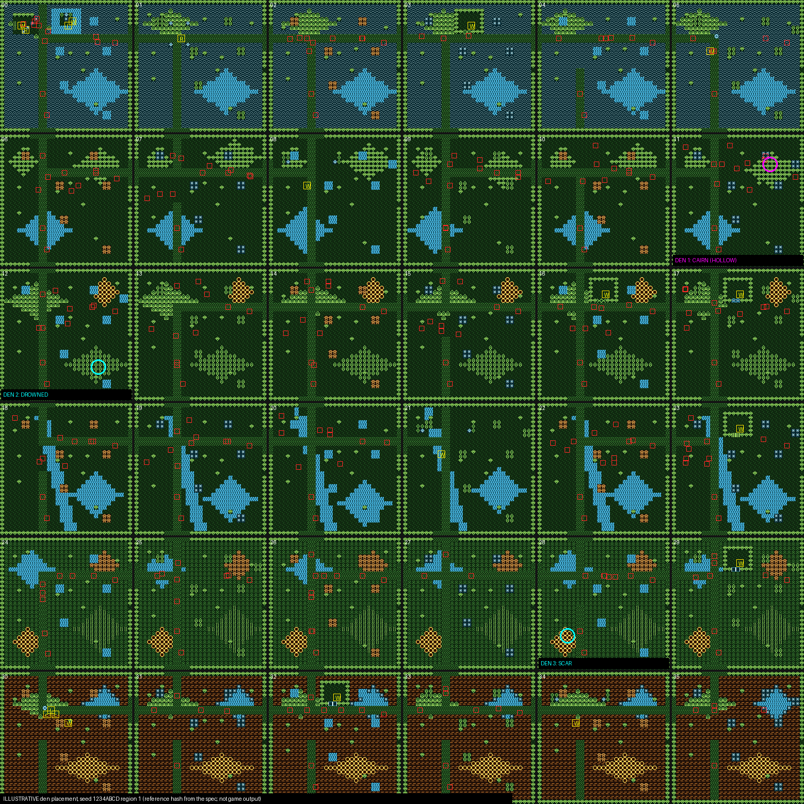
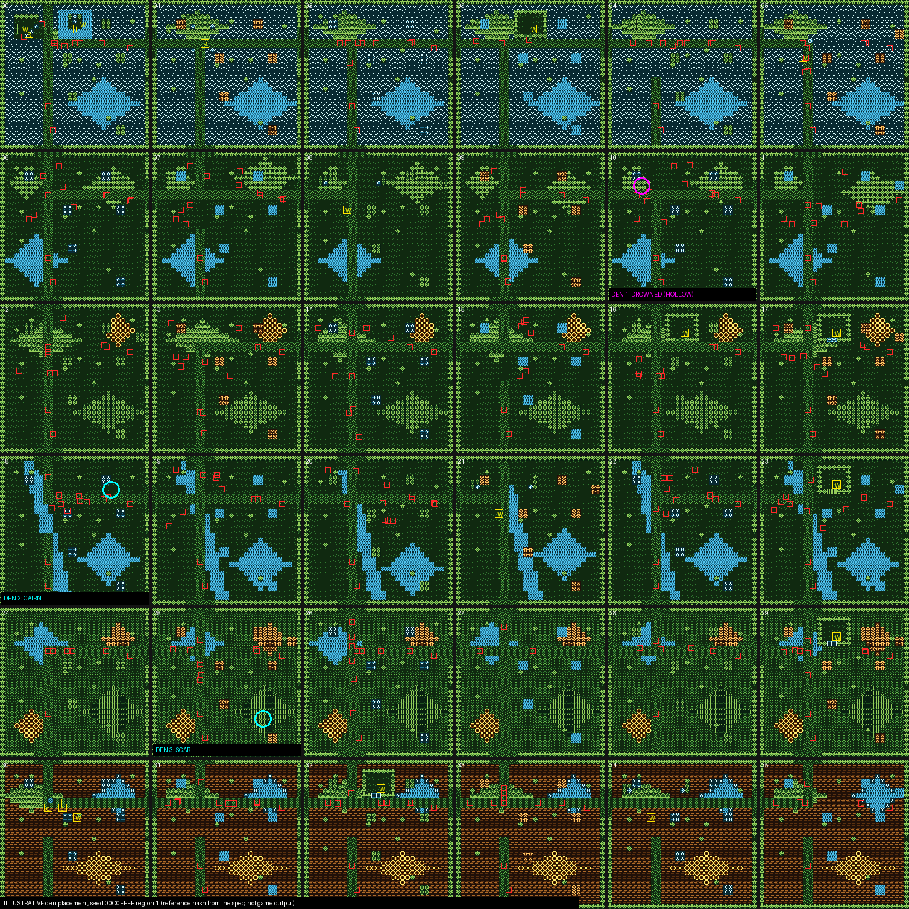
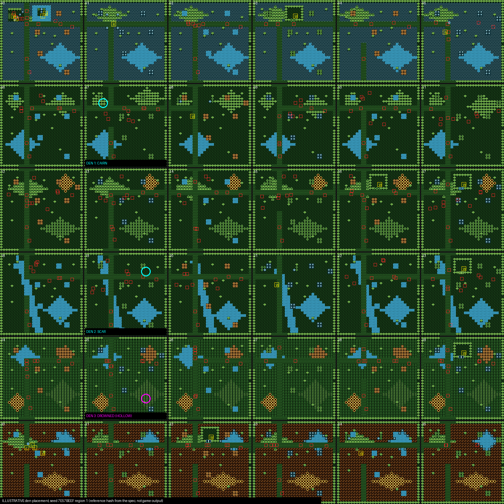

# Riftwild hidden dungeons ("dens")

Date: 2026-11-15 · Status: **proposal for review, nothing implemented**
Audit: [`2026-11-15-riftwild-wonder-audit.md`](2026-11-15-riftwild-wonder-audit.md) (finding F3)

## Goal

Riftwild has no secrets: every gate is an explicit tile with an explanatory
wayfarer beside it, and 22 of 36 fields hold nothing but terrain and enemies.
Hidden dungeons bring back Zelda 1's suspicion that "this rock might be
something", plus a payoff. They are optional, on the same map, with an extra
boss or puzzle, and never on the Warden → Gate main path.

## Design summary

- **3 dens per region**, seeded and persistent like the rest of Riftwild. The
  region map survives all three dungeon trips (`run_state_begin_world`,
  `src/game/regional_riftwild.c:96-125`). Every visit shows **2–3 dens**, since
  all three tells are on the map from the first visit. **Each visit's Warden
  gear guarantees one more den opens.** Class innates can open some dens early.
- Each den has **one subtle tell** in the field, **one gate** made from verbs
  that already exist in code, and **2–4 compact rooms** that end in a puzzle
  chest or a keeper (extra boss).
- **0 new save bytes.** Reserved bits only, no SRAM migration.
- Rewards never touch stat caps.

## What exists in code today (verified on `b304d449`)

| Verb | Source | Notes |
|---|---|---|
| Titan Glove, or Sauran innate | `WAYGEAR_GLOVE`, `src/game/waygear.h:9-31` | passes `BGT_GATE_BOULDER` |
| Tide Raft, or Picsean innate | `WAYGEAR_RAFT` | passes `BGT_GATE_WATER` **and `BGT_WILD_WATER`** |
| Rift Hook, or Corvin innate | `WAYGEAR_HOOK` | passes `BGT_GATE_CHASM` **and `BGT_WILD_HOLE`** |
| Worldglass | `riftwild_shift_execute`, `src/game/riftwild_phase.c:144-196` | Waking ↔ Hollow shift; Riftwild only |
| Bombs (B item, shop) | `secondary_heavy.c:60-77` | 3x3 burst already calls `room_open_secret` on cracked walls |
| Morningstar (B item, shop) | `secondary_heavy_fire` | heavy impact |
| Hookshot (B item, shop) | `src/game/hookshot.c:71-122` | latches wall/pillar/tree/crystal; the pull stops at water (`room_player_position_clear`) |
| Rift Bomb / Echo Chime / Mirror Shard (dungeon consumables) | `src/game/dungeon_tools.c:22-26` | Chime: "expose a secret and nearby paths" |
| Subtle secrets with ordinary art | `src/game/puzzle.c:279-410` | `HIDDEN_SECRET_SHOT/WALK/PUSH`, dungeon only |
| Stair/portal travel with return anchor | `src/game/room.c:2094-2110` | `world_return_screen` low 6 bits = return field |

**No fire tool exists** (fire is only `QSTATUS_BURN` and a class affinity), so
this spec has no "burnable bush" gate. See question 7.

## Placement (seeded)

- **Candidates**: fields with no existing fixture. These are all fields except
  {0, 1, 3, 5, 8, 16, 17, 21, 23, 27, 29, 30, 32, 34}, which hold discovery,
  the riftwell, Warden groves, the cave, gates, class groves, the boss landmark
  and the vault, and except the Hollow relic fields {22, 35}. That leaves 20
  candidates on today's fixed layout. If audit item L3 seeds the layout, this
  list is derived at runtime instead.
- **Spread**: one den per two-row band (rows 0–1, 2–3, 4–5), so dens land in
  different biomes.
- **Hash**: a standalone xorshift32 chain seeded from
  `run_seed ^ region*0x9E3779B9 ^ 'RIFT'`. It never consumes the room RNG, so
  `test_procgen_parity.py` is unaffected for ordinary rooms. A Rust mirror goes
  in `quintra-procgen`. The reference implementation is
  [`assets/riftwild-wonder/den_placement_reference.py`](assets/riftwild-wonder/den_placement_reference.py).
- **Gate per den**: a seeded permutation of {CAIRN, DROWNED, SCAR} over the 3
  bands. **One of the three is Hollow-only** (seeded).
- **Tell spot inside the field**: a quadrant 4–8 tiles from the central trail
  cross. It must not sit on the cross, in a six-tile edge mouth
  (`carve_edge_mouths`, `riftwild_terrain.c:83-98`), in the return landing apron
  or inside an existing stamp. It must be visible from somewhere on the cross.

Illustrative placements from the reference hash on the real atlases (cyan =
Waking den, magenta = Hollow-only den):

|  |  |  |
|---|---|---|

## The three entrances: tell, gate and opening

| Kind | Subtle tell (no amber glow) | Opens with (all existing verbs) | Guaranteed by |
|---|---|---|---|
| **CAIRN**: sealed stone | A standing stone that matches the field's stones except for one faint carved mark (WALL palette, *not* `BGPAL_CRACK`), at the end of a short 3-tile line of the field's accent tile pointing at it | Bombs burst, Rift Bomb, Morningstar impact, or touching it with Titan Glove / Sauran. **Primary shots do not open it** (`projectile.c:284` unchanged), which is what makes it a secret rather than the dungeon's amber crack | Visit 1 Warden drops the Glove |
| **DROWNED**: island stair | A 3x3 island in a pond with a dark stair tile, visible but unreachable (classic Zelda) | Walk over water with Raft / Picsean (existing `WAYGEAR_TILE_PASSABLE`). Optional: let a Hookshot latched to an island pillar pull across water (small change at `hookshot.c:107-111`) | Visit 2 Warden drops the Raft |
| **SCAR**: chasm island | An island ringed by sinkholes, with a lone pillar | Cross sinkholes with Rift Hook / Corvin (existing passability) | Visit 3 Warden drops the Hook |
| **Hollow-only** (any kind above) | In Waking: a "dead ring" of the tell with no stair. In Hollow: the stair is present | The same gate, plus Worldglass (picked up at the first awakened arch) | Same visit as its gate |

Shared rules:

- On opening, the tell becomes a new `BGT_WILD_STAIR` tile and the den's open
  bit is set. Stepping on the stair enters the den, using the same path as the
  portal in `room.c:2094-2110`.
- **Reachability test**: BFS from the trail cross, passing only tiles the
  declared gate allows, must reach the stair. Without the gate it must not.
- Extra tells, in order of cost:
  1. **Echo Chime** used in the field flashes the tell and marks the field on
     the Compass (see Map rules).
  2. A seeded **wayfarer rumour** names the den's biome, e.g.
     `A STONE IN THE FROST / HAS A HOLLOW VOICE`.
  3. An optional one-shot **proximity hum** using an existing SFX.

## Inside a den

- **Rooms**: 2–4 compact single-screen rooms (20x17, no wide streaming), in a
  short chain. Default size by escalation: CAIRN den 2 rooms, DROWNED 3,
  SCAR 4. The Hollow den adds one room, capped at 4.
- **Roles**: Entry (stair up; quiet; optional lore tablet) → Puzzle or Trial →
  End.
  - Puzzle reuses `puzzle.c` kinds (`PUSH_SEAL`, `RUNE_SEQUENCE`,
    `PHASE_SWITCH`, `PHASE_GATE`), keyed on the den seed.
  - Trial reuses the dungeon-director encounter kinds.
  - **End is either a treasure chest (puzzle den) or a keeper (boss den)**,
    seeded 50/50. The Hollow den is always a keeper.
- **Keeper**: uses the existing mini-boss path (`is_miniboss`,
  `procgen.c:1232-1235`). The roster is drawn from a mini-boss of a *different*
  stage, so it is a surprise but has no new AI or art. Hollow keepers use the
  existing Hollow hardening (`riftwild_harden_enemy`, `riftwild_phase.c:228-240`:
  +50% HP, +1 contact).
- **Look**: the atlas of the stage the player is about to enter (already loaded
  per stage in `tiles_stage.c`), with a cave palette. No new interior tiles.
- **Exit**: the entry room's stair returns to the parent field at the tell.
  After the end room is cleared, a one-way stair there returns too (Zelda 1
  style).
- **Music**: the existing stage track for that atlas. No new music.

## Rewards (stat-cap safe)

Puzzle dens give one chest. Keeper dens offer a two-way choice using the
existing `PICKUP_BOON_CHOICE`. The pool deliberately has **no permanent stat
items** (Iron Heart, Mana Gem, PowerStone, Tough Skin, Speed Ring, Lucky Coin),
so the HP 16 / MP 20 / ATK 15 / DEF 10 / SPD 9 / LCK 10 caps in `pickup.c` are
never involved.

| Reward | Mechanism |
|---|---|
| A rare passive from a curated "wild" pool; duplicates convert to coins | `pickup_spawn_item` |
| **Wild Chart**: the next dungeon's layout | sets `next_dungeon_reveal*`, copied in by `run_state_begin_dungeon` (`regional_riftwild.c:127-141`) |
| **Riftwell re-arm**: one more full restore at the riftwell | clears `RIFT_REGION_WELL_USED_BIT` |
| Dungeon tools: Rift Bomb, Echo Chime, Mirror Shard | existing consumables |
| Coins x10 + full heal | existing pickups |

A claim bit is set on pickup, so re-entering shows an empty chest and no
keeper.

## Save, suspend and state (0 new bytes)

| State | Where | Notes |
|---|---|---|
| Inside a den, which den, which room | `world_screen = 36 + den*4 + room` (36..47) | `world_screen` is documented as 0..35. `run_state_world_cell_seen` / `reveal` already ignore cells ≥ 36 (`regional_riftwild.c:38-58`) |
| Return field | `world_return_screen` low 6 bits | same pattern as the cave stairs (`room.c:2104-2107`); bit 7 `RIFTWELL_USED_FLAG` preserved |
| Den opened (x3) | `world_seen_xxhi` bits 4–6 | the upper nibble is documented as reserved (`run_state.h:134`) |
| Den cleared or claimed (x3) | `riftwild_shadow` bits 4–6 | currently unused |

- **Required fix:** `run_state_begin_world` masks
  `riftwild_shadow &= RIFT_SHADOW_RELIC_MASK` on every return to Riftwild
  (`regional_riftwild.c:119`). Widen the mask to `0x7E` so den claims survive
  dungeon trips. A new region already zeroes both bytes, so each region gets
  fresh dens.
- `sizeof(run_state_t)` is unchanged, so there is no `sram_migrate` path. Old
  suspends load with every den closed.
- The suspend already happens on every room entry. Resuming inside a den
  regenerates the room deterministically from (run_seed, region, den, room).
  Death wipes the run as usual.
- **Hollow**: a den entered from Hollow returns to Hollow. Worldglass is
  disabled inside dens (an early return in `riftwild_shift_execute`).
- **Guard every `screen_grid[run_state.world_screen]` read** through one helper
  (`riftwild_field_screen()` returns the parent field while in a den), or
  `world_screen ≥ 36` indexes past the 36-entry grid:
  `procgen.c:548, 648, 899, 985, 1035, 1845`, `room.c:2098, 2224`, and the
  caller of `companion_ask.c:38`.

## Map rules (earned, consistent with `2026-11-12-earned-compass-map.md`)

- Unopened dens are **never** drawn, and charts never reveal them.
- **Echo Chime** used in a den's field marks that field with a dim chest glyph
  (`BGT_MAP_CACHE`, tile 122, already in the map atlas). The reveal is earned
  by using a consumable in the right place.
- An opened den shows the bright chest glyph on its field node, below
  HERE/GATE/BOSS in priority. A claimed den reverts to the plain node.
- Inside a den, SELECT shows the Riftwild map with HERE on the parent field and
  a `DEN` heading (`BGT_AREA_D/E/N` already exist). No separate den map is
  needed for 2–4 linear rooms.

## Budgets

| Resource | Cost | Where |
|---|---|---|
| ROM: placement, tells, opening | about 0.7 KB | bank 11 (1335 B free) or a new autobank |
| ROM: den generation, roles, rewards | about 2.5–3 KB | new `#pragma bank 255` file (banks 18–31 are empty in the 512 KB image) |
| ROM: den room templates | 4–6 stamp lists x about 150 B ≈ 1 KB | same bank |
| ROM: guards | about 200 B spread | keep `room.c`'s bank to a single BANKED call (bank 1 has 266 B, bank 7 368 B, bank 15 318 B free) |
| VRAM | +2–3 BG tiles (marked cairn, stair, optional island rim) | VRAM bank 1 `0x9000–0x97FF` (only the Hexa arena uses it) |
| WRAM | 0 persistent; about 4 B transient statics | — |
| SRAM | 0 | reserved bits |
| Entities / OAM | existing 32-slot table; keeper = mini-boss slots | — |
| Music / SFX | 0 new | — |

## Tests (when implemented)

`scripts/test_riftwild_dens.py`, headless PyBoy, checks:

- Placement is deterministic per (seed, region): 3 distinct bands, never a
  fixture field.
- Each tell is reachable from the cross only with its declared gate.
- Primary shots do not open a cairn; Bombs, Morningstar, Rift Bomb and Glove
  do.
- Suspend in den room 2, resume: same room and terrain.
- Claim bits survive a dungeon trip and reset on region change.
- The Compass hides unopened dens.
- No stat item ever rolls.
- `test_procgen_parity.py` is unchanged, plus new den-room parity seeds.
- The Rust placement mirror matches the ROM for 50 seeds.

## Rollout

1. **P1**: placement, tells, gates and open bits; each stair leads to a single
   treasure room. This is a playable slice.
2. **P2**: 2–4 room interiors with puzzle and keeper roles, plus rewards.
3. **P3**: the Hollow-only den, Echo Chime reveal and wayfarer rumours.

## Questions for Carmelo

1. **Count**: 3 dens per region (all tells visible from visit 1; each visit's
   Warden gear opens one more), or 2–3 *fresh* dens on every visit (9 per
   region; needs 1–2 new save bytes and a migration)?
2. **Early access**: may class innates and shop B items (Bombs, Morningstar,
   Hookshot) open dens early, or should each den wait for its visit's Warden
   gear?
3. **Hollow den**: one Hollow-only den per region as the stand-in for
   day/night: yes or no?
4. **Keepers**: reuse other stages' mini-bosses (cheap, about 0 art), or new
   den-only bosses (GPT Image 2.6 art and new AI)?
5. **Rewards**: OK with no stat items at all in dens? The pool would be a rare
   passive, Wild Chart, riftwell re-arm, tools, or coins and a heal.
6. **Size**: 2 / 3 / 4 rooms escalating by visit, or seeded 2–4?
7. **Fire**: no fire tool exists. Add one (for example a fire Oath that burns
   marked bushes) for a fourth gate, or skip fire?
8. **Hookshot over water**: allow a Hookshot pull across water to an island
   pillar (small change), or keep water strictly Raft/Picsean?
