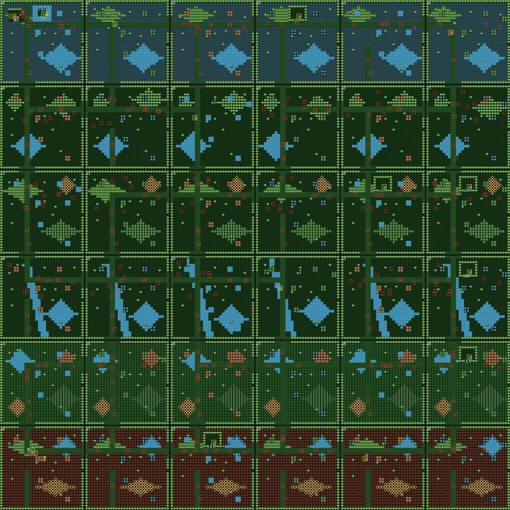
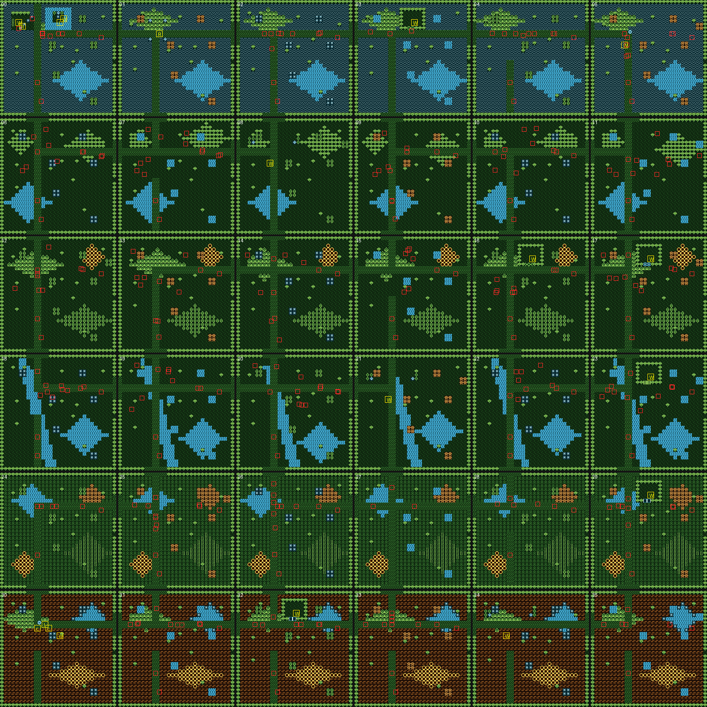
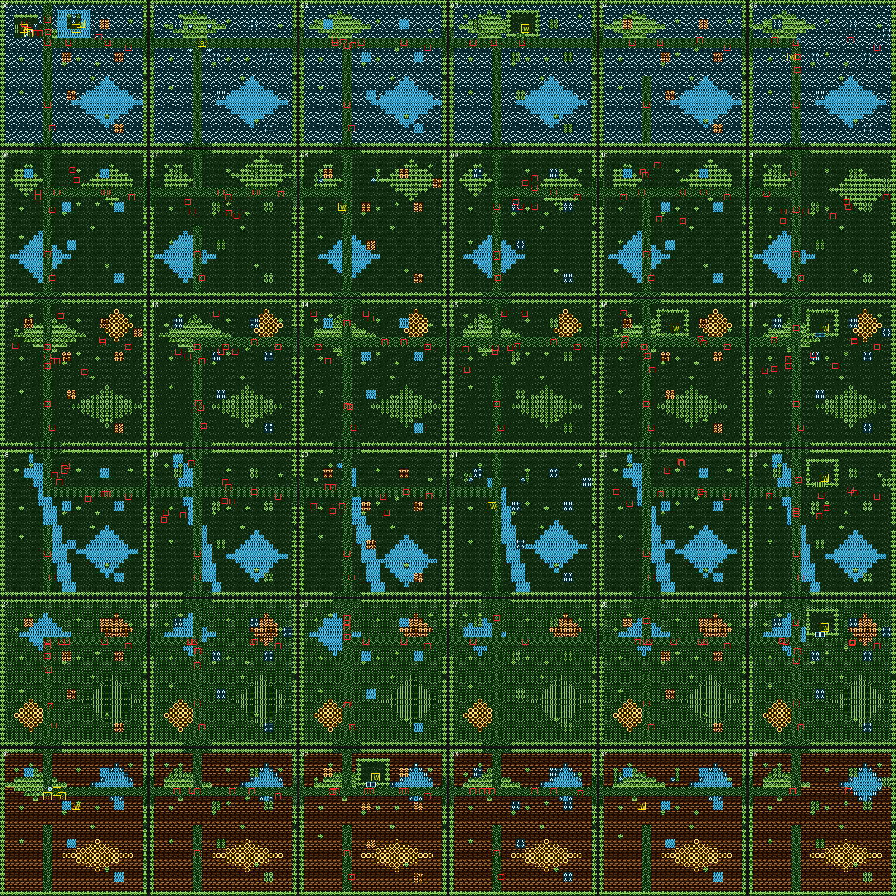
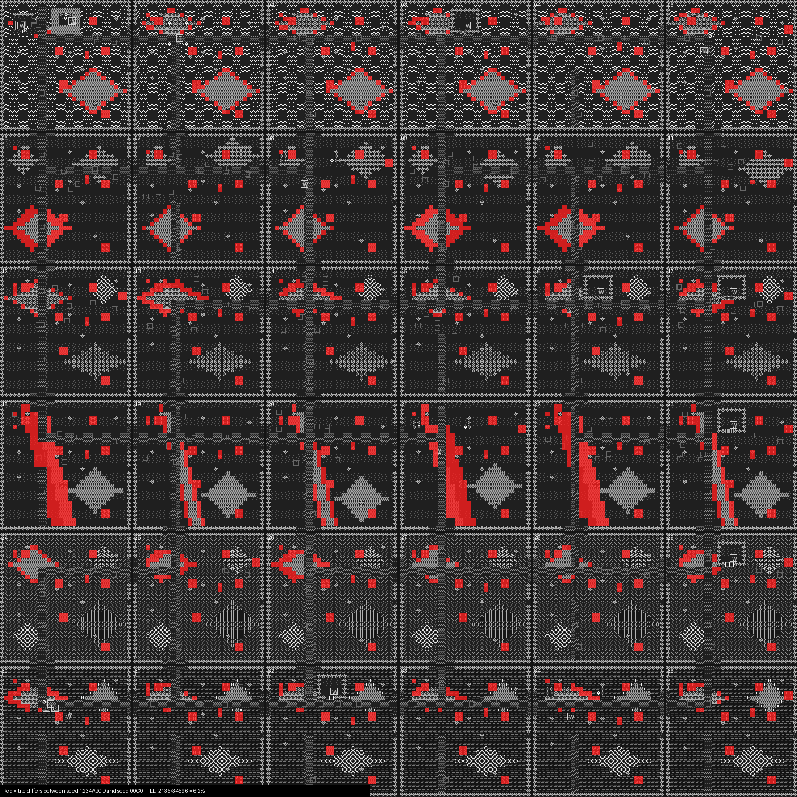
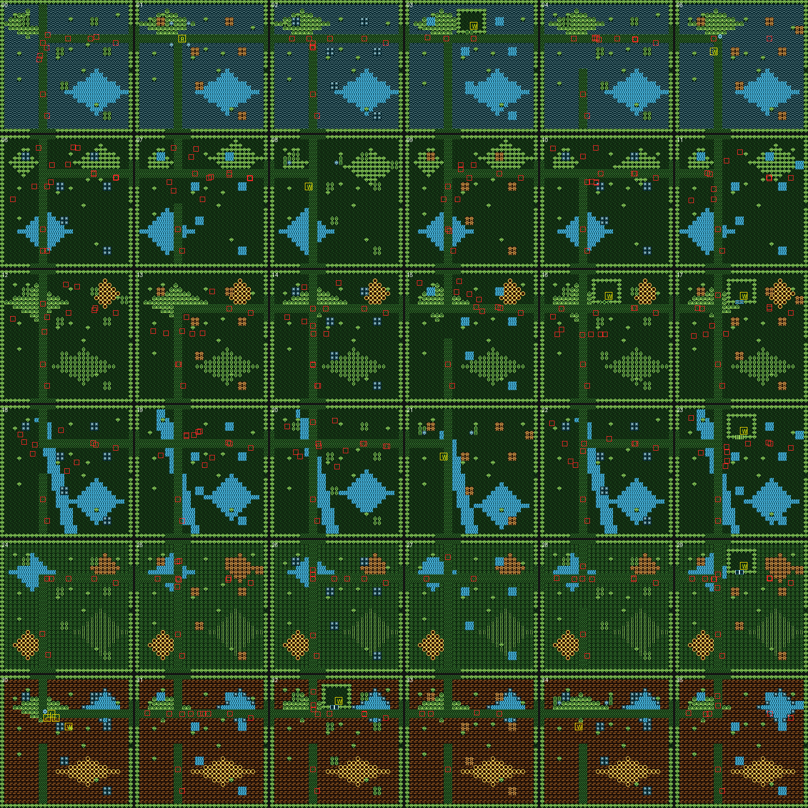
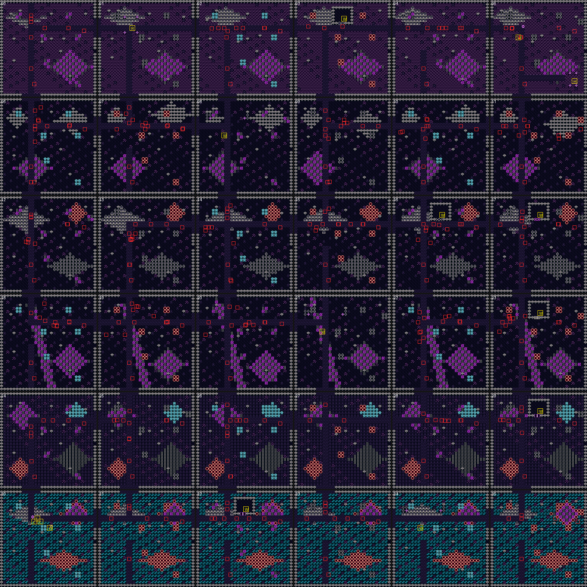

# Riftwild sense-of-wonder audit and punch list

Date: 2026-11-15 · Status: **proposal for review, nothing implemented**
Companion spec: [`2026-11-15-riftwild-hidden-dungeons.md`](2026-11-15-riftwild-hidden-dungeons.md)

## Question

Riftwild (the 6x6 overworld between dungeons) is missing the sense of wonder of
Zelda 1's overworld or Final Fantasy Adventure. Is that the tiles, or a lack of
open-world feel?

**Short answer: both, but mostly layout and secrets, not the tile art.** The
world is essentially the same map every run and every region. Each biome row is
one field copied six times. The "landmarks" are the same small blob stamped at
the same coordinates in all 36 fields. Nothing is hidden, so there is nothing to
suspect. Tile art compounds this: every terrain type is one repeated 8x8 tile
with no edges. The art is the cheapest part to fix in GBC budget terms, but on
its own it would only make the same map prettier.

## Method (reproducible, headless)

- Built `origin/main` at `b304d449` on blackmage (`make gen && make
  rom/working/quintra.gbc`).
- [`assets/riftwild-wonder/capture_riftwild_atlas.py`](assets/riftwild-wonder/capture_riftwild_atlas.py)
  boots the ROM in PyBoy with `window="null"` (no GUI). It sets `run_seed`,
  uses the existing `test_overworld` boss-exit fixture and walks the
  `test_riftwild_landmarks.ROUTE` depth-first route through all 36 fields over
  real seams. For each field it renders the logical 31x31 tile map from WRAM.
  `room_draw_tilemap()` writes the BGT id as the VRAM tile index and
  `render_attr()` chooses the palette (`src/game/room_render.c:118-260`), so the
  output uses the cartridge's live tile graphics and palette RAM. It is
  not polluted by stale off-screen BG rows from the streamed seam slide.
- Yellow boxes are pickups and NPCs (W wayfarer, R riftwell, I item, G waygear,
  H Hollow relic). Red boxes are live hostiles at capture time.
- The metrics below were computed from the dumped tile grids (the JSON beside
  each PNG on the review box).

Run: `python3 docs/superpowers/specs/assets/riftwild-wonder/capture_riftwild_atlas.py 0 1 0x1234ABCD`
(first argument is unused; the second is `bosses_beaten`; suffix a seed with `h`
for the Hollow counterpart).

### Atlases (6x6 fields, each 248x248 px, cell index top-left)

| Atlas | What it shows |
|---|---|
|  | Seed `0x1234ABCD`, first Riftwild (after boss 1), Waking |
|  | Seed `0x00C0FFEE`, same visit |
|  | Seed `0x7E57BEEF`, same visit |
|  | Red marks every tile that differs between two seeds: 6.2% |
|  | Same seed, region 2 (after boss 4): 93% identical to region 1 |
|  | Same seed, Worldglass Hollow counterpart |

## Measured metrics

| Metric | Riftwild (measured, 3 seeds) | Zelda 1 overworld (design reference) | FF Adventure (design reference) |
|---|---|---|---|
| Same field, different seed: identical tiles | **93.8–95.4%** (min 83.8%) | n/a (fixed, hand-authored) | n/a (fixed, hand-authored) |
| Same seed, region 1 vs region 2 | **93.3%** identical | n/a | n/a |
| Field vs its most-similar other field | **91.9%** identical on average (80–97.5%) | Few screens share a composition; columns are reused but arranged per screen | Region-themed screens; towns, caves and set pieces break repetition |
| Fields in the same row (biome) | **83–92%** identical pairwise | Biomes are patches (lake, graveyard, mountain, woods), not rows | Biomes are contiguous regions you journey between |
| Distinct tile types per field | **4–11** (mean 7.2) | Each screen is built from a varied tile set with edges | Same |
| Single most common tile covers | **62%** of every field | Ground is broken up by edges, rocks, trees and water shapes | Same |
| Terrain art | 1 x 8x8 tile per terrain, no edges or corners (`src/render/tiles.c:446-455`) | Edged shorelines, cliffs, tree clumps | Edged terrain, 16x16 metatiles |
| BG palettes for terrain | 5 shared by all six biomes (`src/game/riftwild_phase.c:28-34`) | Per-area colour (green, brown, grey) | Per-region colour |
| Walkable share | 70–80% in **every** field | Varies a lot, from tight mazes to open fields | Varies |
| Open directions from the start | Return field 0: **2** (E, S); field 8: 3; field 21: **2** | 3 exits plus the sword cave on screen 1 | A guided start, then the map opens |
| Graph | 51 of 60 lattice edges open, fixed in code | Varied barriers make sub-regions | Barriers and tools make regions |
| Fields with any point of interest | **14 of 36** in Waking (+2 Hollow-only relic fields); **22 fields have nothing but terrain and enemies** | Almost every screen has a secret, a cave, a landmark or a shop | Towns, caves, NPCs and tool-gated paths |
| Hidden (unmarked) secrets | **0**: every gate is an explicit tile and a wayfarer explains it | Many: bombable walls, burnable bushes, pushable rocks and graves, raft and ladder spots | Tool-gated: the axe cuts trees, the sickle cuts grass, the mattock breaks rocks |
| Visible-but-unreachable | 1 authored island (field 0, `riftwild_discovery.c`), 6 explicit gate groves | Common: islands, ledges, a heart behind rocks | Common |
| Hostiles per field at arrival | median **12**, max 16 (0 only in 5 special fields) | Usually a handful per screen | A few per screen |

The Zelda 1 and FFA columns are design references from the published games,
not tool measurements. The Riftwild column is measured from the ROM.

## Findings, with code

### F1. The seed barely changes the world (biggest wonder killer)

- The 6x6 graph, with its ridge cuts and cell kinds, is a `const` in
  `content/src/zelda_overworld.rs:35-60` and `:72-120`, duplicated in
  `src/game/riftwild_terrain.c:39-63`.
- Return, gate and Warden fields are fixed per visit:
  `src/game/regional_riftwild.c:11-13` (`{0,8,21}`, `{8,21,34}`, `{3,17,29}`).
  The class groves are fixed at fields 16, 23 and 32 (`src/game/waygear.c:72-80`),
  and the Hollow relics at 5, 22 and 35 (`src/game/riftwild_phase.c:201`).
- Biome = row (`zone = world_screen / 6`, `riftwild_terrain.c:164`). Each row's
  big terrain stamp sits at fixed centres with at most 3 tiles of jitter from
  `salt & 3` (`riftwild_terrain.c:176-224`).
- The landmark "family" uses only the **low byte** of the run seed:
  `(u8)run_seed + world_screen + region) & 3` (`src/game/procgen.c:986-988`).
  So the whole seed space collapses to 4 rotations of the same pattern.
- This breaks the World Cadence contract ("Most rooms, routes, puzzles, towns,
  and encounters derive from the run seed",
  `2026-07-13-world-cadence-and-lore.md`). By the second run a player has seen
  the whole Riftwild.

### F2. Every field is the same field with a different tint

- `stamp_world_landmark()` puts the same 2x2 blob at **the same eight
  coordinates** in every field (`procgen.c:152-161`). So do
  `generate_world_extension()` and `generate_world_bottom()` (`procgen.c:166-235`).
  The "four-part landmark" is one 2x2 tile clump in four colours.
- `carve_edge_mouths()` and the trail code produce the same 2-tile "+" path
  cross through the centre of every field (`procgen.c:993-1003`,
  `riftwild_terrain.c:83-98`). It reads as an arena with a cross, not land.
- Result: on average a field is 92% identical to some other field in the same
  run. Zelda 1 works because each screen has *one* thing you can point at: a
  lone tree, a graveyard, a lake shape, a rock maze.

### F3. Nothing is secret, so nothing invites suspicion

- Every gate is an explicit gate tile in a tree-walled box
  (`waygear.c:33-52`, `BGT_GATE_*`), and a wayfarer stands beside it to explain
  it (`waygear.c:70-80`).
- The dungeon "cracked wall" secret glows amber on purpose
  (`procgen.c:904-923`, `BGPAL_CRACK`), and Riftwild has none at all.
- Dungeons already have a *subtle* secret system that keeps ordinary wall and
  cairn art (`src/game/puzzle.c:279-410`: `HIDDEN_SECRET_SHOT/WALK/PUSH`), but
  Riftwild never uses it.
- 22 of 36 fields contain no point of interest, which is why it feels like
  "walk to the next screen". The hidden-dungeon spec addresses this directly.

### F4. Mission pull is thin, and partly misleading

- In Riftwild the Pack goal always reads `FIND DUNGEON`
  (`src/game/inventory_goal.c:11`), even while the arch is sealed and the real
  goal is the Warden.
- The Compass never marks the Warden field (`src/game/map.c:176-219`: no guard
  icon). The only directional pull is the gate wayfarer's hard-coded
  `SEEK NORTHEAST` (`src/game/dialog.c:178`). That is always true because the
  Warden is always north-east of the gate (F1).
- The arrival fields 0 and 21 open only 2 ways, and field 0 starts in the corner
  of the grid.

### F5. Density and openness are uniform

- Every field is 70–80% walkable with a median of 12 hostiles. There are no
  quiet fields, no tight forest or canyon fields and no wide plains. Wonder
  needs contrast and some breathing room.

### F6. Tiles: single 8x8 tiles, no transitions, shared palettes

- Grass, trees, water, mountain, holes, sand, snow and mud are each **one** 8x8
  tile (`tiles.c:446-455`, `tiles.h:167-188`). Lakes are stair-stepped diamonds
  made by `stamp_land()` (`riftwild_terrain.c:68-81`) with no shoreline.
- All six biomes share 5 BG palettes (`riftwild_phase.c:28-34`). Biomes differ
  mainly by ground tile.
- **Budget is available.** On CGB, VRAM bank 1's BG-only region
  `0x9000–0x97FF` (128 tiles) is loaded by nothing except the Hexa arena (16
  tiles at index 40, `src/render/hexa_bg.c:159-162`). Riftwild uses only bank-0
  ids 35–39 and 96–110.

## Prioritized punch list

Costs: S under a day, M 1–3 days, L about a week. Budgets come from the
`b304d449` link: ROM is 512 KB (32 banks) with banks 0–17 used, so **banks
18–31 (about 224 KB) are free at no cart-size cost**. Free bytes per bank:
bank 10: 993, bank 11 (terrain): 1335, bank 14 (phase): 1376, bank 17: 12705.
`_DATA` ends at 0xD395. Every proposal below fits without a new save byte unless
noted.

### Layout, openness and mechanics (do these first)

| # | Change | Why (finding) | Cost | Budget notes |
|---|---|---|---|---|
| L1 | **Hidden dungeons**: 3 per region, seeded, subtle tells, gated by existing gear (companion spec) | F3; adds suspicion and payoff | L | about 3–4 KB ROM in a new autobank; 0 new save bytes (reserved bits); 3–6 BG tiles |
| L2 | **One set piece per field**: a library of about 20 authored 6x6–10x10 stamps (stone circle, giant lone tree, ruined shrine, broken bridge, graveyard, waterfall cliff, skull rock, camp, obelisk, mushroom ring, sunken arch, crystal spire…). The seed picks one per field with no repeats in a region. They replace the 8-coordinate blob. | F2 | M | stamps RLE about 60–120 B each, so about 2 KB in bank 17 or 18; 10–20 BG tiles in VRAM bank 1 |
| L3 | **Seed the geography**: biome *patches* (2x2/3x2 cell blobs) instead of rows; ridge cuts from a pool with a reachability check; Warden, gate and return fields from candidate lists; use all 32 seed bits | F1 | M | about 1 KB in bank 10 or 11; requires rewriting the tests pinned to fixed cells (`test_riftwild_landmarks`, `test_overworld`, `test_regional_riftwild`) and the Rust mirror in `quintra-procgen` |
| L4 | **Fix the mission text and Compass**: Pack shows `FIND WARDEN` until the guard is down, then `FIND GATE`. The Compass marks the Warden field as GOAL once a wayfarer names it (same "earned" rule as the dungeon map) | F4 | S | under 150 B; uses the existing GOAL tile |
| L5 | **Contrast in density**: Riftwild encounter cap of 3–6 per field, about 1 in 4 fields quiet (wayfarer, vista, set piece) | F5 | S | spawn-count constant; must keep `procgen_repair_enemy_spawns` invariants |
| L6 | **Break the "+"**: trails meander, fork or dead-end into a set piece; some fields are tight (forest, canyon), some wide plains | F2, F5 | M | edge-mouth contract (`carve_edge_mouths`) stays; touches pathing tests (`test_corvin_riftwild_pathing.sh`, `test_rift_sigil_pathing.sh`) |
| L7 | **Visible-but-unreachable**: at least one island or ledge per biome with something on it, gated by Raft, Hook or Glove through the existing `WAYGEAR_TILE_PASSABLE` (`waygear.h:23`) | F3 | S–M | 0 new mechanics; overlaps L1 |
| L8 | **Arrival vista**: return fields open 3+ ways and show at least 2 tells or set pieces from the arrival point | F4 | S | data only once L3 lands |

### Tile and art work

| # | Change | Why | Cost | Budget notes |
|---|---|---|---|---|
| A1 | **Edge autotiling** for water, mountain, hole and tree canopy at draw time (render only; collision ids unchanged): 4 edges + 4 outer + 4 inner corners per terrain | F6; lakes stop being diamonds | M | about 48 tiles in VRAM bank 1 `0x9000–0x97FF` (attribute bit 3), 768 B ROM + about 400 B of code in `tiles_stream_wide_row`; computed per streamed row, so no WRAM buffer |
| A2 | **Ground variation**: 2–3 variants each of grass, snow, sand and mud chosen by position hash, render only | F6; 62% of each field is one tile | S | 8–12 tiles, about 100 B of code |
| A3 | **2x2 tree-canopy metatiles** so the forest border reads as a forest | F6 | S | 4–8 tiles |
| A4 | **Per-biome palettes**: load a 5-palette set per biome on field entry instead of one shared set | F6 | S | 40 B per biome of ROM; check whether BG slots 5–7 are free in the field (HUD and status use) before spending more than 5 |
| A5 | Set-piece art for L2 | F2 | M | 10–20 tiles (bank 1) |
| A6 | Hidden-dungeon tell and stair tiles (L1) | F3 | S | 3–6 tiles; interiors reuse the stage atlas |

**Suggested order:** L4 and L5 (an afternoon, immediate feel) → A1–A3 + L2
together (the visual identity pass) → L1 hidden dungeons → L3 seeding → L6–L8.
A1–A3 alone would make the screenshots prettier, but without L1–L3 every run
would still show the same map.

## Out of scope here

Day/night stays parked. The existing Waking/Hollow Worldglass shift is
already a two-state world, so the hidden-dungeon spec uses it as the stand-in
(one Hollow-only den per region).
