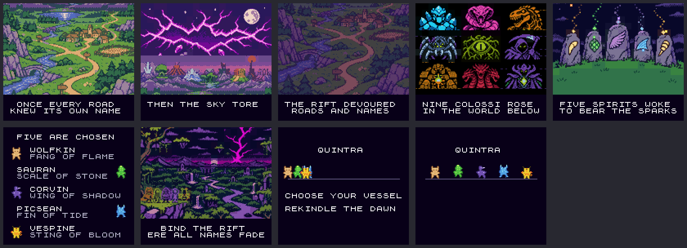

# Intro animation and stage-transition vignettes (spec, not implemented)

Status: **proposal for struktured's review. Nothing is built in the ROM.** This PR
adds only this spec, previews and the preview tooling. No ROM, itch, rivalmage or SD-card change.

Requests (2026-11-16):
- "A little sprite intro animation capturing the lore of the game, Game Boy pixel style. Ultima: Runes of Virtue for GB has animated stuff perfect for this."
- "Maybe even an animation per stage transition."
- "Including entering Riftwild."

## Style reference: Ultima: Runes of Virtue (GB, 1991)

From the attract and credits sequence:
- Plain white-on-black text cards.
- Framed illustrated panels.
- "YOUR FRIENDS / YOUR FOES" parades: one sprite beside each name, appearing one by one.
- Hard cuts, slow scrolls and 4-step palette fades. No full-motion animation.

Quintra borrows that grammar:
- One text band (window layer, rows 15-16).
- Full-width panels that pan using SCX and SCY.
- Sprite parades.
- Cheap motion: tile swaps, palette cycling, ≤ 6 OBJ.

## How the previews were made

- **Keyframe art.** gpt-image-2.6-sunburst made 10 calls (11 images, $0.47 logged), each at `medium` quality.
- **Downscaling.** Each image was box-downscaled to its panel size.
- **Quantizing to real CGB limits.** Every 8x8 tile picks one 4-colour RGB555 palette. Each panel uses ≤ 7 BG palettes, with palette 7 kept for the font.
- **Tile budget.** Tiles were reduced to the budgets below by greedy merging of near-identical same-palette tiles.
- **Text and heroes.** Text uses the real `font_min` glyphs, cut from ROM screenshots. `X` is hand-drawn in the same style because the font has no `X` yet. The heroes are the real 16x16 class sprites.
- **Output.** Logic runs at 60 fps. Previews are rendered at 30 fps: 160x144 GIF plus a 4x MP4.

Previews:
- `docs/previews/intro/quintra-intro.gif` and `quintra-intro-4x.mp4`, plus `storyboard-sheet.png`.
- `docs/previews/intro/transitions/`:
  - `riftwild-enter`
  - `riftwild-enter-hollow`
  - `stage3-ember-depths`
  - `transitions-sheet.png`
  - `all-stages-sheet.png`

## 1. Intro: 7 shots, 23 s (1380 frames), on boot before the title

| # | Frames | Text (rows 15-16) | Picture and motion |
|---|---|---|---|
| 1 | 0–179 | ONCE EVERY ROAD / KNEW ITS OWN NAME | Valley panorama 160x240. SCY pans from sky to land (0→128, eased) in 140 f. 4-step fade in. |
| 2 | 180–419 | THEN THE SKY TORE → THE RIFT DEVOURED / ROADS AND NAMES | Hard cut back to the sky. The Rift grows over rows 0-7 in 4 tile-swap steps (every 20 f). A 70 f shake of ±2 px (SCX/SCY), with one 4 f palette lift. At 120 f the view pans down the *same* valley, and the land palettes dim two steps toward violet. |
| 3 | 420–599 | NINE COLOSSI ROSE / IN THE WORLD BELOW | "YOUR FOES" parade: nine 48x32 boss busts pop in on a 3x3 grid, one every 12 f, each with a 2 f flash. |
| 4 | 600–779 | FIVE SPIRITS WOKE / TO BEAR THE SPARKS | Ring of five standing stones carved with the class sigils. Five OBJ sparks in class colours rise and loop. |
| 5 | 780–1019 | FIVE ARE CHOSEN | "YOUR FRIENDS" list. Every 32 f a hero slides in (walk toggle by H-flip), alternating left and right, with name and epithet: FANG OF FLAME, SCALE OF STONE, WING OF SHADOW, FIN OF TIDE, STING OF BLOOM. 0 new tiles. |
| 6 | 1020–1199 | INTO THE WILD BELOW → BIND THE RIFT / ERE ALL NAMES FADE | The five vessels, seen from behind on a cliff, look down into the Riftwild. The Rift stands on the horizon. Diagonal pan (SCX 32→0, SCY 0→16) ends on them. |
| 7 | 1200–1379 | CHOOSE YOUR VESSEL / REKINDLE THE DAWN → PRESS START | QUINTRA at row 3. The five heroes walk in onto a ground line; this is the existing title procession. Hands off to the title state. |

The lines reuse the title's lore beats (`title.c` `render_lore_beat`). Shot 6 still ends on the canonical *BIND THE RIFT / ERE ALL NAMES FADE*.

Controls:
- START skips to the title. START is ignored for the first 20 frames.
- The intro plays once per power-on, before the first title.
- Option: replay it as attract after 30 s of title idle. **Decision for struktured.**

## 2. Stage-transition vignettes: 3 s each (180 f), one per stage plus Riftwild

**Shape.** No separate card. The framed 112x96 vignette fades in: tile col 3, row 1, with a ROV-style double-line frame.
- The stage name is on row 15 and a motto on row 16, each ≤ 18 chars so there is a 1-tile margin.
- The hero (the player's class sprite) walks up the path into the entrance and fades out over 3 OBJ-palette steps.
- One signature effect plays.
- Then a fade, or a white lift for Riftwild, into the first room.

| Timing | Frames |
|---|---|
| Fade in | 0–15 |
| Walk and effect | 16–130 |
| Exit | 130–179 |

| Vignette | Row 15 | Row 16 | Signature effect (cost) |
|---|---|---|---|
| Riftwild, entering (prototype) | WAKING RIFTWILD | THE WILD REMEMBERS | The arch interior opens from a magenta tear line in 5 steps, every 12 f. The jagged edges are 4 edge-tile shapes, X-flipped. The hero walks through, then a white lift. |
| Riftwild, Hollow phase (prototype) | HOLLOW RIFTWILD | THE WILD FORGETS | Same tiles, Hollow palette set (48 B). |
| Riftwild, leaving | — | — | **No vignette.** Walking into a dungeon gate *is* the leave beat. It cuts straight to that dungeon's vignette, so two cutscenes never play back to back. |
| 1 Crystal Caverns | CRYSTAL CAVERNS | CRYSTALS LISTEN | glint: rotate one crystal palette colour |
| 2 Verdant Hollow | VERDANT HOLLOW | THE ROOTS HUNGER | 4 OBJ falling leaves, flower palette pulse |
| 3 Ember Depths (prototype) | EMBER DEPTHS | THE KILN WAKES | lava palette cycle every 10 f; the walkway is darkened to charcoal so the hero reads; Cinder Rex eyes blink, then flare (2 OBJ) |
| 4 Frost Vault | FROST VAULT | NOTHING THAWS HERE | 6 OBJ snowflakes |
| 5 Toxic Mire | TOXIC MIRE | A DARK HEART BEATS | heartbeat palette pulse, bubble cycle |
| 6 Shadow Keep | SHADOW KEEP | THE GATE WATCHES | torch palette flicker; portcullis rises in 3 tile-swap steps |
| 7 Golden Temple | GOLDEN TEMPLE | THE SUN NEVER SETS | sun palette ramp |
| 8 Bloodmoon | BLOODMOON | THE MOON BLEEDS | moon pulse, 3 OBJ bats |
| 9 Void Sanctum | VOID SANCTUM | WHERE NAMES END | 4 OBJ stone shards drift up, plus a rift-shimmer palette (no LYC SCY wobble, which would bend the frame rails) |

Hexa sanctum: no vignette, so the secret is kept. Decision for struktured.

**Repeat and skip policy (fatigue):**
- A, B or START skips from frame 8.
- The full vignette plays the first time each dungeon or Riftwild phase is entered in a run.
- Re-entries (dungeon return, endless descent) get none, or at most the 16 f fade.
- Settings toggle `CUTSCENES ONCE / OFF`. It lives in the ROM's options and is mirrored in the web Settings panel.
- Worst case in a full run: 9 dungeons + 3 Riftwild entries, about 36 s in total.

## 3. Asset budget (measured on the quantized previews)

| Asset | Size | Unique tiles | Tile bytes | ROM map+attr (packed) |
|---|---|---|---|---|
| Valley (shots 1-2) | 160x240 | 355 | 5.7 KB | 1.2 KB |
| Rift overlay (shot 2, rows 0-7) | 160x64 | 112 new | 1.8 KB | 0.32 KB |
| Boss busts (shot 3) | 160x112 (9 × 48x32) | 216 | 3.5 KB | 0.56 KB |
| Shrine (shot 4) | 160x112 | 172 | 2.8 KB | 0.56 KB |
| Cliff (shot 6) | 192x128 | 320 | 5.1 KB | 0.77 KB |
| Shots 5 and 7 | font + class OBJ | 0 | 0 | 0 |
| One vignette | 112x96 | ≤ 128 | 2.0 KB | 0.34 KB + 48 B palettes |
| 10 vignettes (9 stages + Riftwild) | | | 20 KB | 3.8 KB |
| Rift edge tiles (Riftwild) | | 4 | 64 B | — |
| Font: `X` (TOXIC MIRE) | | 1 | 16 B | — |

Totals:
- Intro: about 23 KB. Vignettes: about 24 KB. Code: about 2.5 KB.
- **About 50 KB in all, uncompressed.** Today's 512 KB ROM has banks 18–31 empty (14 × 16 KB), so this fits in 4 banks with no ROM-size change.
- With `gbcompress` or RLE the total is about 30 KB (2 banks). Data decompresses to a WRAM buffer first.
- Each panel stays whole inside one bank.

**VRAM:**
- **Tile addressing.** BG uses 8800 (signed) addressing. Index 0..127 maps to `0x9000`, and 128..255 maps to `0x8800`. The converter must emit indices `id ^ 0x80` when it writes linearly from `0x8800`.
- **Index capacity.** 2 banks × 256 = 512 BG indices. Font tiles 0..36 plus one blank leave **474**.
- **Peak use is shot 2:** valley 355 + Rift overlay 112 + 38 = 505 ≤ 512. This is why the valley is capped at 356, and why the torn valley is an overlay plus a palette dim, not a second image (which would cost 398 tiles).
- **BG map.** The fixed 32x32 VRAM map (1 KB map + 1 KB attributes) holds the 160x240 valley and the 192x128 cliff with no streaming. ROM keeps maps packed (w×h) and copies them row by row.

**Loading and display:**
- **Loading:** no LCD-off. Load under black palettes with VBlank GDMA, ≤ 2 KB per VBlank. The largest panel (valley, 5.7 KB + 2 KB map/attr) takes 4 VBlanks, about 67 ms, invisible during the fade.
- **Text band:** window layer at WY=112, WX=7, on black palette 7. It hides the pan seams underneath.
- **OBJ:** ≤ 10 per line. The title ground row holds 5 heroes × 2 = 10, the same as today's title. Sparks, leaves, shards and eyes never share the hero rows.
- **Palettes:** ≤ 7 BG palettes per panel. Effects only rewrite palette RAM, ≤ 2 palettes per frame. Tile-map writes are ≤ 8 cells per frame, inside VBlank.

## 4. Implementation plan (after approval; not in this PR)

1. **Asset pipeline.** `tools/intro_assets.py`: checked-in quantized PNGs go to C arrays (tiles, packed map and attributes, palettes, `^0x80` indices). It is deterministic and runs from `make gen`. Hand-clean the palette assignment on the busts and the valley. The preview tooling is in `docs/superpowers/specs/assets/intro/tools/`.
2. **Engine code.** `src/game/intro.c` and `src/game/vignette.c` with `#pragma bank 255` and `BANKED` entry points. Shots and vignettes are data-driven `const` tables (frame ranges, text, scroll targets, effect id).
3. **Hooks:**
   - boot → intro → `title_enter`;
   - dungeon entry and Riftwild entry → `vignette_play(id)`, gated by the per-run seen bits in WRAM (no SRAM change) and by the `CUTSCENES` option.
4. **Tests:**
   - PyBoy golden PNG per shot and vignette;
   - START skip at frames 0, 20 and 500, and A/B/START skip in vignettes from frame 8;
   - 0 lag frames over the intro and every vignette in the benchmark harness;
   - VRAM index ≤ 511 assertion in the converter;
   - `scripts/check_rom_layout.py`;
   - hardware check on rivalmage only when struktured asks.

## 5. Review history

- **Carbon review 1** (`gemini-4-carbon`, $0.049): `docs/previews/intro/carbon-review-rev1.md`. Applied in this revision:
  - The intro is cut from 33 s to 23 s, and the tear and devour shots are merged into one shot.
  - The boss parade now uses dedicated busts instead of room captures.
  - The cliff hero is now the five vessels looking down, under a darker sky.
  - CHOOSE YOUR VESSEL replaces THE ROGUELIKE.
  - The vignette card is folded into the vignette, which is now 3 s with mottos ≤ 18 chars.
  - Riftwild-leave is dropped.
  - The Void Sanctum LYC wobble is replaced with OBJ shards.
  - The Riftwild reveal now uses jagged tear edges inside the arch, not black bars.
  - The Ember walkway is darkened.
  - The budget numbers are corrected: VRAM stride, signed indexing, GDMA instead of LCD-off, and the torn valley as an overlay.
- **Not applied:** Carbon's Shot 2 suggestion to replace the nine horizon landmarks with plain ridgelines. They foreshadow the nine dungeons; this is struktured's call.

## 6. Open decisions for struktured

1. Intro length (23 s) and whether it replays as attract on title idle.
2. Vignette policy: first entry per run (proposed), every entry, or off by default.
3. Hexa sanctum: no vignette (proposed) or a "SIXTH SPARK" teaser.
4. Mottos: keep the table above or reuse more title-lore lines.
5. Horizon landmarks in shot 1-2: keep (proposed) or simplify.
